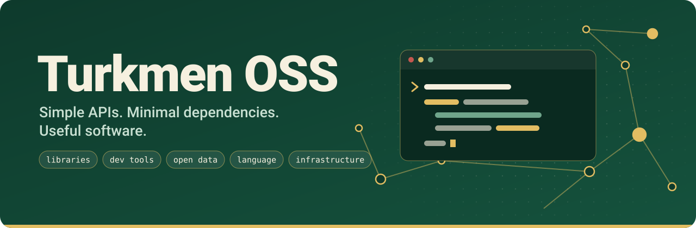

# Turkmen OSS

**Open-source software for the Turkmen ecosystem.**

We build libraries, developer tools, open data, language tooling, and infrastructure for Turkmen communities worldwide.

Simple APIs. Minimal dependencies. Useful software. Built and maintained by people.

**Open source for Turkmen developers, language, data, and technology.**
