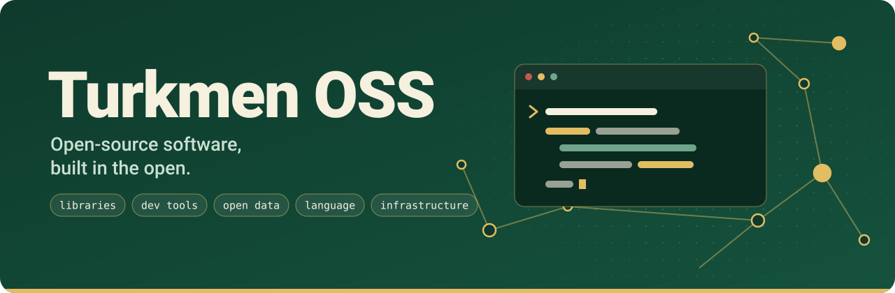

# Turkmen OSS

**Open-source software, built in the open.**

We build libraries, developer tools, open data, language tooling, and infrastructure for developers everywhere.

Simple APIs. Minimal dependencies. Useful software. Built and maintained by people.

**Open source for developers, language, data, and technology.**
